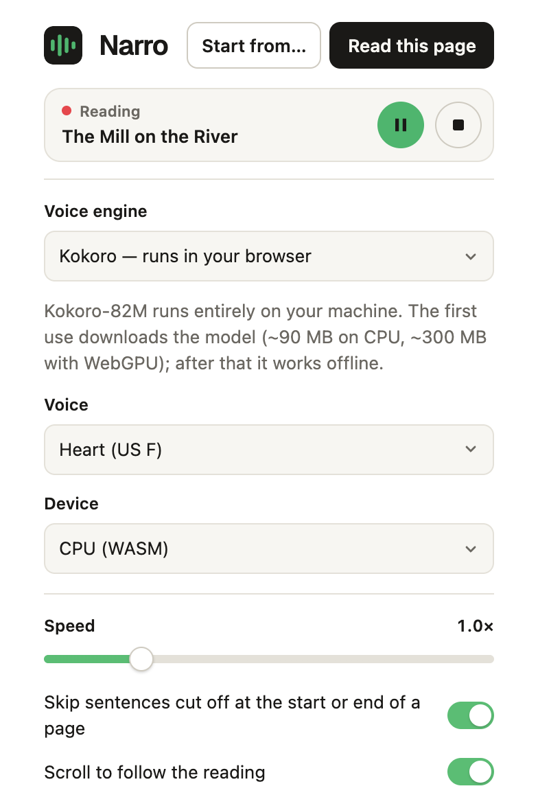
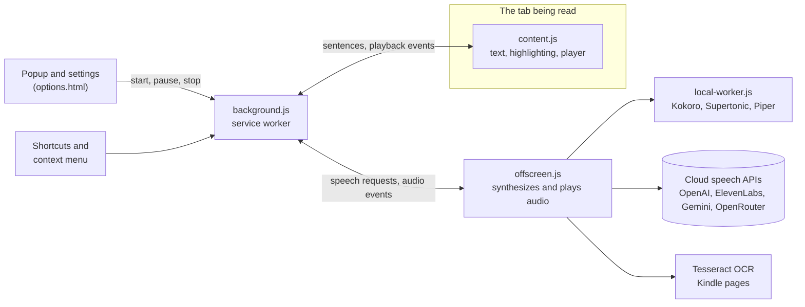

<div align="center">


# Narro

**Read any web page aloud with on device AI voices. Supports Kindle online reader.**

<a href="https://chromewebstore.google.com/detail/lhkhhmceefdlfikeoojjihjclmjhkjko"></a>

[Features](#features) · [Privacy](#privacy) · [Report an issue](https://github.com/swrdfish/Narro/issues)

[](https://chromewebstore.google.com/detail/lhkhhmceefdlfikeoojjihjclmjhkjko) [](https://github.com/swrdfish/Narro/actions/workflows/test.yml) [](LICENSE)

</div>

Narro is a Chrome extension that reads the page you're on and highlights each sentence as it's
spoken. Use a cloud voice with your own API key, or a voice that runs entirely in your browser,
with no account and no server. It also supports Kindle Online Reader.

<table>
  <tr>
    <td width="68%"></td>
    <td width="32%"></td>
  </tr>
  <tr>
    <td align="center"><sub>Sentence highlighting and the floating player</sub></td>
    <td align="center"><sub>The popup: controls and settings</sub></td>
  </tr>
</table>

## Features

### Voices

| | Engine | Notes |
|---|---|---|
| **Cloud** | OpenAI | `gpt-4o-mini-tts` with style instructions, `tts-1`, `tts-1-hd` |
| | ElevenLabs | Your own voices, listed with your key |
| | Google Gemini | Gemini TTS voices |
| | [OpenRouter](https://openrouter.ai) | One key for speech models from many providers |
| **In your browser** | Kokoro-82M | 8 voices in English |
| | Supertonic 2 | 10 voices in English, Spanish, French, Portuguese and Korean |
| | Piper | Popular [piper-voices](https://huggingface.co/rhasspy/piper-voices) in several languages |
| **Other** | Local server | Any OpenAI-compatible `/v1/audio/speech` server, e.g. [Kokoro-FastAPI](https://github.com/remsky/Kokoro-FastAPI) |
| | System voices | Your computer's built-in voices |

### What the in-browser voices need

Each model downloads once and then works offline. Memory is what Narro uses in total at its peak
while reading, as Chrome's Task Manager shows it.

| Model | Download | Memory while reading |
|---|---|---|
| Kokoro-82M on CPU | 92.4 MB | about 700 MB |
| Kokoro-82M on WebGPU | 325.5 MB | about 1050 MB |
| Supertonic 2 on CPU | 262.9 MB | about 950 MB |
| Supertonic 2 on WebGPU | 262.9 MB | about 800 MB |
| Piper, medium-quality voice | 63.2–63.5 MB | about 800 MB |
| Piper, high-quality voice | 113.9–120.8 MB | about 800 MB |

Download sizes are the model files on Hugging Face. Memory was measured in Chromium on an M1 Pro,
reading a 12-paragraph article with the model already downloaded, and rounded to 50 MB; expect some
variation between machines. Most of it is the speech runtime the three engines share, which is why
a small Piper voice needs about as much as Kokoro. Kokoro and Supertonic use WebGPU when **Device** is
**Auto** and the browser supports it; the popup shows the figures for your setup.

### Reading

- **Sentence highlighting**, without changing the page. The page scrolls to follow along.
- **Natural speech:** consecutive sentences are sent as one request, so the voice keeps its intonation. The first sentence is sent on its own, so speech starts quickly.
- **Play/pause, previous/next sentence**, and speed from 0.5× to 3× with pitch preserved.
- **Start anywhere:** Point and select capability. Select text and right-click → *Read aloud from here*.
- **Resumes where you left off** on each page.
- **Control it from any tab:** the popup shows what's being read, with pause and stop. The toolbar icon shows a red ▶︎ while it plays.
- **Kindle Cloud Reader:** reads book pages with on-device OCR and turns pages automatically ([details](#kindle-cloud-reader)).


## Install

Install Narro from the [Chrome Web Store](https://chromewebstore.google.com/detail/lhkhhmceefdlfikeoojjihjclmjhkjko), then click the Narro icon on any page,
choose a voice engine and press **Read this page**.

### Build from source

To try the latest changes before they reach the store:

```sh
git clone https://github.com/swrdfish/Narro.git
cd Narro
npm install
npm run build
```

1. Open `chrome://extensions` and turn on **Developer mode**.
2. Choose **Load unpacked** and select the `dist/` folder.
3. Click the Narro icon, choose a voice engine, then **Read this page**.

Keyboard shortcuts are shown in the popup and can be changed at `chrome://extensions/shortcuts`.


## Privacy

- **Text you have read aloud**: with a cloud voice, the text is sent to that provider (OpenAI, ElevenLabs or Google) under your account and their terms. With OpenRouter, it goes to OpenRouter and the model's provider. With local models like Kokoro, Supertonic, Piper or system voices, nothing leaves your computer. A local server receives the text at the address you configure.
- **API keys** are stored in `chrome.storage.local` on your computer. They're never synced and never sent anywhere except to the provider they belong to.
- **Model downloads**: in-browser voices download their model files from Hugging Face on first use, then cache them in your browser.
- **Reading positions**: Narro stores a short fingerprint of the last sentence you heard on each page, plus its position, for up to 200 pages. These stay on your computer and don't include the text itself.
- **Narro has no analytics, accounts or servers of its own**.

## Kindle Cloud Reader

Kindle Cloud Reader shows book pages as images rather than text, so on `read.amazon.com`, `.co.uk`, `.in`, `.de`, etc. Narro runs
**OCR (text recognition) on the page you can see**, entirely on your computer, using Tesseract. It then reads the recognized text with your chosen voice.

- At the end of a page, Narro presses Kindle's **Next page** button and keeps reading. It can turn the page slightly early, while the page's last sentence is still playing, so there's no pause. Both behaviours can be switched off in the settings.
- A sentence split across a page turn or a column break is spoken once, in full.
- Reading continues if the Kindle tab is hidden behind another window. If Kindle doesn't draw the next page while hidden, Narro waits until the tab is visible again.
- OCR currently supports English only. Decorative fonts, very small text and illustrations reduce accuracy.

> Narro is an independent project. It isn't affiliated with or endorsed by Amazon. Kindle is a
> trademark of Amazon.com, Inc. Narro only reads pages you have open yourself, but automated use of
> Kindle Cloud Reader may be restricted by Amazon's terms. Check that your use complies with them.

## Model and voice lists

The **Model** dropdowns for OpenAI, ElevenLabs and Gemini, and the **Piper** voice list, come from
`src/models.json`. Each list maps an ID to the label shown in the dropdown:

```json
{ "openai": { "tts-1": "tts-1 · fastest" }, "piper": { "en_US-lessac-medium": "Lessac · US English, female" } }
```

The `local` section holds the download size and memory of each in-browser model, shown in the popup:
per device (`wasm` for CPU, `webgpu`) for Kokoro and Supertonic, and per voice for Piper. A Piper
voice added to the list needs an entry there too.

```json
{ "local": { "piper": { "en_US-lessac-medium": { "downloadMB": 63.2, "memoryMB": 800 } } } }
```

- To make a permanent change, edit `src/models.json` and run `npm run build`.
- To make a quick change without rebuilding, edit `dist/models.json` and reload the extension. The next build overwrites this copy.

A saved model that's missing from a list stays selectable. The local server's model list comes from
its own `/v1/models` endpoint.

## Development

```sh
npm run watch          # rebuild the extension on changes
npm test               # test suite (Node's test runner + jsdom)
npm run site:preview   # preview the landing page (site/) at http://localhost:8000
```

After a rebuild, reload Narro at `chrome://extensions`, then reload the tab you're testing on. See
[CONTRIBUTING.md](CONTRIBUTING.md) for guidelines.

Found a bug or have an idea? [Open an issue](https://github.com/swrdfish/Narro/issues). You can also use the
**Send feedback or report an issue** link at the bottom of Narro's popup.

### Architecture

Narro is a Manifest V3 extension with no framework and no build-time code generation: plain ES
modules bundled by esbuild.




**Design notes**

- Audio plays in an offscreen document, so a page's security policy can't block it, and cloud APIs are called from the extension's own origin.
- Each speech request carries a sequence number, so the page ignores events from requests it has already replaced.
- While reading, the page holds a connection to the background. Refreshing or closing the page stops playback.

## Licence

Narro's source code is released under the [MIT License](LICENSE).

The built extension also includes third-party components under their own licences, including
**eSpeak NG (GPL-3.0-or-later)** through the phonemizer used by Kokoro and Piper. See
[THIRD_PARTY_NOTICES.md](THIRD_PARTY_NOTICES.md) for details, including the licences of models that
are downloaded at runtime.
